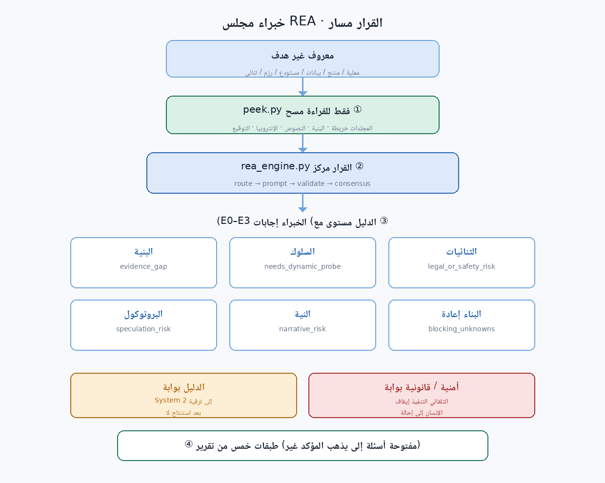
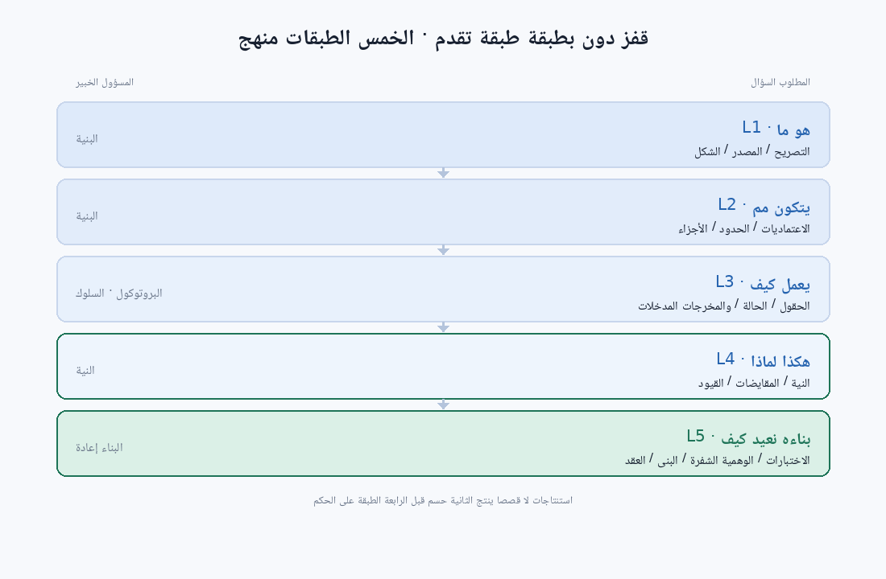

# مجلس خبراء REA (Reverse Engineer Anything)

حوّل **هدفًا غير معروف** إلى شيء قابل للشرح وإعادة الإنتاج — ملفًا ثنائيًا، أو التقاط حزم، أو مستودعًا، أو ملف بيانات، أو واجهة منتج، أو حتى عملية أعمال.

ينسّق **مركز قرار** بين **6 خبراء متخصصين**، ويدفع **منهجية إعادة البناء الخماسية**، مع آلية مدمجة **لمنع الهلوسة** (تصنيف الأدلة E0–E3 + بوابة فجوة الأدلة + بوابة قانونية/أمنية).



- **بلا تبعيات**: مكتبة Python القياسية فقط — لا `pip install`، ولا أوزان مُنزَّلة.
- **بلا شبكة**: كل الحكم يُجرى محليًا.
- **معاينة للقراءة فقط**: `peek.py` لا يعدّل الهدف ولا ينفّذه أبدًا.
- تقيد السكربتات المخرجات وتتحقق من الثقة وتسجّل مستويات الأدلة؛ والبيئة التي تُحمّل هذه المهارة هي من تنفّذ التحليل الفعلي.

---

## البداية السريعة

```bash
# 1) المعاينة — أولًا نرى ما هذا
python3 scripts/peek.py <مسار>                # ملف: سحر/إنتروبيا/نصوص/بنية
python3 scripts/peek.py <مجلد> --depth 3       # مجلد: توزيع الأنواع/نقطة الدخول/الإنتروبيا العالية

# 2) التوجيه — أي الخبراء هذه المرة
python3 scripts/rea_engine.py route --state 'التقاط ثنائي مجهول البنية ببنية TLV'

# 3) طرح السؤال + 4) التحقق
python3 scripts/rea_engine.py prompt  --schema-file experts/protocol-decoder/schema.json --state '<وصف>'
python3 scripts/rea_engine.py validate --schema-file experts/protocol-decoder/schema.json \
    --state '<وصف>' --answer '{"format_class":{"value":"tlv","confidence":0.8,"evidence":"E2"}}'

# 5) الإجماع والتدقيق
python3 scripts/rea_engine.py consensus --results @results.json
python3 scripts/rea_engine.py audit

# الفحص الذاتي
python3 scripts/rea_engine.py selftest
```

---

## منهجية إعادة البناء الخماسية

| الطبقة | تجيب على | الخبير الرئيسي |
|---|---|---|
| L1 ما هذا | الصيغة، المصدر، حالة الترخيص | structure-anatomist |
| L2 مِمَّ تتكوّن | الأجزاء، الحدود، الاعتماديات، نقطة الدخول | structure-anatomist |
| L3 كيف تعمل | مدخل→مخرج، الحالة، دلالة الحقول | behavior-analyst / protocol-decoder |
| L4 لماذا هكذا | القيود، المفاضلات، قصد التصميم | intent-reconstructor |
| L5 كيف نعيد بناءها | العقد، البنية، الكود الوهمي، القبول | rebuild-planner |

تقدَّم طبقة تلو الأخرى — بلا تخطٍّ. الحديث عن L4 قبل وضوح L2 عادةً قصٌّ لا استنتاج.



## مجلس الخبراء

| الخبير | يملك | البوابة الرئيسية |
|---|---|---|
| `structure-anatomist` | تمييز الصيغة، تفكيك الأجزاء، الحدود والاعتماديات | `evidence_gap` |
| `behavior-analyst` | السلوك وقت التشغيل، آلة الحالة، التوقيت، الآثار الجانبية | `needs_dynamic_probe` |
| `binary-reverser` | الثنائي/البايت-كود، الرموز، التعمية، تدفّق التحكم | `legal_or_safety_risk` (→ بشري) |
| `protocol-decoder` | الرسائل وصيغ البيانات، حدود الحقول ودلالاتها | `speculation_risk` |
| `intent-reconstructor` | القيود، المفاضلات، قصد التصميم | `narrative_risk` |
| `rebuild-planner` | تثبيت المواصفات، العقد، الكود الوهمي، القبول | `blocking_unknowns` |

## تصنيف الأدلة (جوهر منع الهلوسة)

| المستوى | المعنى | يدخل الاستنتاج؟ |
|---|---|---|
| E0 | ملاحظة مباشرة (بايتات / سطر مصدري / مخرج تشغيل) | ✅ |
| E1 | استنتاج قوي (سلسلة كاملة، كل حلقة E0) | ✅ مع ذكر السلسلة |
| E2 | استنتاج ضعيف (نمط / خبرة، احتمالات أخرى واردة) | ⚠️ وسم "مستنتَج" |
| E3 | تخمين (بلا دليل مباشر) | ❌ فقط في "فرضيات للتحقق" |

---

## بنية المجلدات

```
rea-expert-council/
├── SKILL.md                     # نقطة دخول المهارة
├── skillhub.json                # بيانات نشر SkillHub
├── icon.png                     # أيقونة 512×512
├── scripts/
│   ├── rea_engine.py            # مركز القرار (route/prompt/validate/decide/consensus/audit)
│   ├── peek.py                  # معاينة الهدف بلا تبعيات
│   ├── install.py               # نشر مهارات الخبراء الفرعية
│   └── publish.py               # بناء حزمة رفع SkillHub
├── experts/
│   ├── _registry.json           # سجل الخبراء (الأوزان + كلمات التشغيل)
│   └── <domain>/{SKILL.md,schema.json}   # 6 خبراء
├── assets/schemas/              # أنماط مشتركة (فرز / تدقيق منع الهلوسة)
├── references/                  # المنهجية: method / evidence / engine / expert-team
└── tests/run_tests.py           # اختبارات السلسلة الكاملة
```

---

## حدود صريحة

- الثقة **تقدير ذاتي**، ليست احتمالًا معياريًا؛ للأعمال عالية المخاطر اضبط `min_confidence ≥ 0.7`.
- `peek.py` يقوم بالمعاينة للقراءة فقط — بلا فك تشفير، بلا فك حزم، بلا تنفيذ.
- **الخط الأساسي التأملي دون اتصال** المدمج في المحرّك (سحر/إنتروبيا/كلمات مفتاحية) مرجع موضوعي.
- لا يوفّر ولا يقوم بـ: تجاوز الترخيص، كسر تراخيص البرمجيات التجارية، أو تسليح شيفرة خبيثة.

## التثبيت المحلي

```bash
python3 scripts/install.py                 # مستوى المستخدم
python3 scripts/install.py --scope project # مستوى المشروع
python3 scripts/install.py --uninstall     # إزالة
```

## الترخيص

MIT — راجع [LICENSE](LICENSE).
