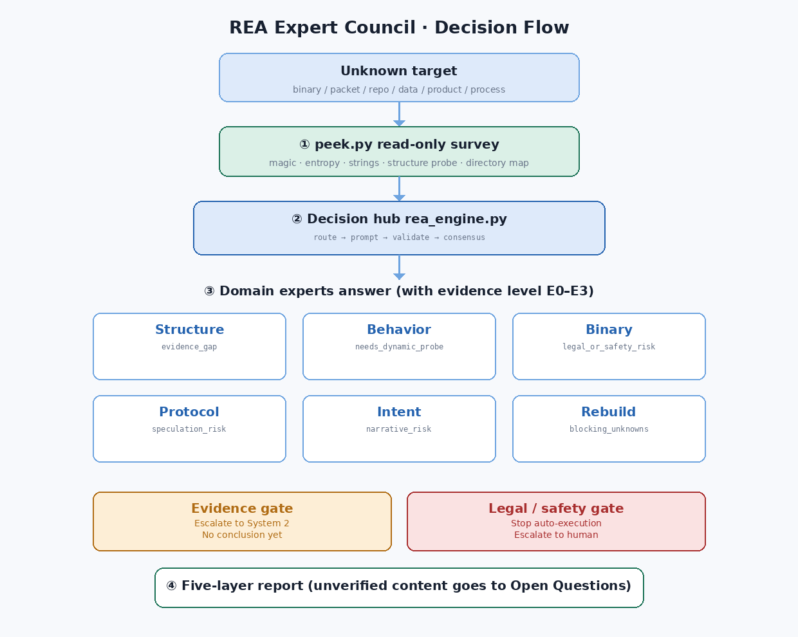
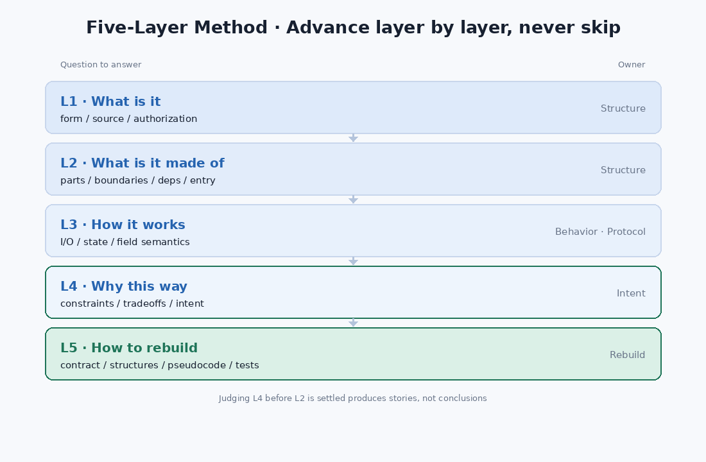

# REA Expert Council (Reverse Engineer Anything)

Turn an **unknown target** into something explainable and reproducible — a binary, a packet capture, a repository, a data file, a product UI, or even a business process.

A **decision core** coordinates **6 domain experts** and drives the **five-layer reconstruction method**, with a built-in **anti-hallucination mechanism** (E0–E3 evidence grading + evidence-gap gate + legal/safety gate).



- **Zero dependencies**: pure Python standard library — no `pip install`, no downloaded weights.
- **Zero network**: all judgment runs locally.
- **Read-only triage**: `peek.py` never modifies or executes the target.
- Scripts constrain output, validate confidence, and record evidence levels; the runtime that loads this skill performs the actual analysis.

---

## Quick start

```bash
# 1) Triage — first see what it is
python3 scripts/peek.py <path>                # file: magic/entropy/strings/structure
python3 scripts/peek.py <dir> --depth 3       # dir: type distribution/entry/high-entropy

# 2) Route — which experts this time
python3 scripts/rea_engine.py route --state 'unknown binary capture with TLV structure'

# 3) Prompt + 4) Validate
python3 scripts/rea_engine.py prompt  --schema-file experts/protocol-decoder/schema.json --state '<desc>'
python3 scripts/rea_engine.py validate --schema-file experts/protocol-decoder/schema.json \
    --state '<desc>' --answer '{"format_class":{"value":"tlv","confidence":0.8,"evidence":"E2"}}'

# 5) Consensus & audit
python3 scripts/rea_engine.py consensus --results @results.json
python3 scripts/rea_engine.py audit

# self-test
python3 scripts/rea_engine.py selftest
```

---

## The five-layer reconstruction method

| Layer | Answers | Lead expert |
|---|---|---|
| L1 What is it | form, origin, authorization status | structure-anatomist |
| L2 What is it made of | parts, boundaries, dependencies, entry point | structure-anatomist |
| L3 How does it work | input→output, state, field semantics | behavior-analyst / protocol-decoder |
| L4 Why this way | constraints, trade-offs, design intent | intent-reconstructor |
| L5 How to rebuild | contract, structure, pseudocode, acceptance | rebuild-planner |

Proceed layer by layer — no skipping. Talking about L4 before L2 is clear is usually storytelling, not conclusion.



## The expert council

| Expert | Owns | Key gate |
|---|---|---|
| `structure-anatomist` | form recognition, part decomposition, boundaries & dependencies | `evidence_gap` |
| `behavior-analyst` | runtime behavior, state machine, timing, side effects | `needs_dynamic_probe` |
| `binary-reverser` | binary/bytecode, symbols, obfuscation, control flow | `legal_or_safety_risk` (→ human) |
| `protocol-decoder` | messages & data formats, field boundaries & semantics | `speculation_risk` |
| `intent-reconstructor` | constraints, trade-offs, design intent | `narrative_risk` |
| `rebuild-planner` | spec hardening, contract, pseudocode, acceptance | `blocking_unknowns` |

## Evidence grading (anti-hallucination core)

| Level | Meaning | Into conclusion? |
|---|---|---|
| E0 | Direct observation (bytes / source line / run output) | ✅ |
| E1 | Strong inference (full chain, every link E0) | ✅ cite the chain |
| E2 | Weak inference (pattern / experience, alternate explanations possible) | ⚠️ label "inferred" |
| E3 | Speculation (no direct evidence) | ❌ only into "hypotheses to verify" |

---

## Directory structure

```
rea-expert-council/
├── SKILL.md                     # skill entry point
├── skillhub.json                # SkillHub publish metadata
├── icon.png                     # 512×512 icon
├── scripts/
│   ├── rea_engine.py            # decision core (route/prompt/validate/decide/consensus/audit)
│   ├── peek.py                  # zero-dependency target triage
│   ├── install.py               # deploy expert sub-skills
│   └── publish.py               # build SkillHub upload package
├── experts/
│   ├── _registry.json           # expert registry (weights + trigger words)
│   └── <domain>/{SKILL.md,schema.json}   # 6 experts
├── assets/schemas/              # shared schemas (triage / anti-hallucination audit)
├── references/                  # methodology: method / evidence / engine / expert-team
└── tests/run_tests.py           # full-chain tests
```

---

## Honest boundaries

- Confidence is a **self-reported estimate**, not a calibrated probability; for high-stakes work set `min_confidence ≥ 0.7`.
- `peek.py` only does read-only triage — no decryption, no unpacking, no execution.
- The engine's built-in **offline heuristic baseline** (magic / entropy / keywords) serves as an objective reference.
- It does not provide, and will not: bypass authorization, crack commercial licensing, or weaponize malicious code.

## Local install

```bash
python3 scripts/install.py                 # user-level
python3 scripts/install.py --scope project # project-level
python3 scripts/install.py --uninstall     # uninstall
```

## License

MIT — see [LICENSE](LICENSE).
