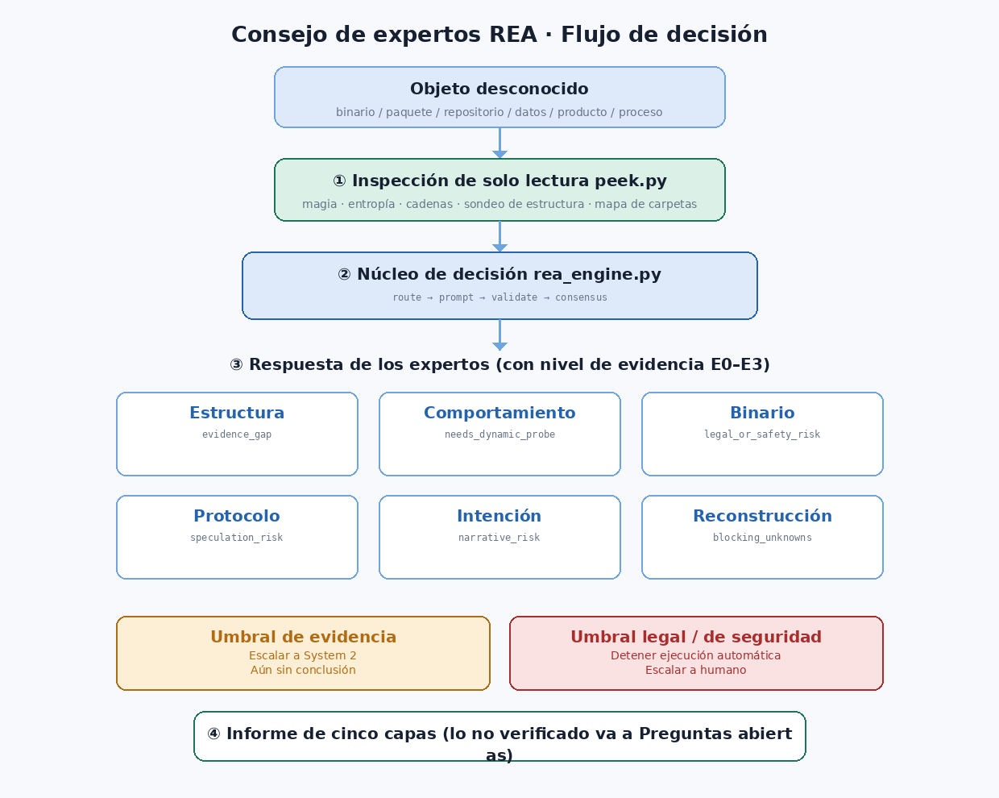
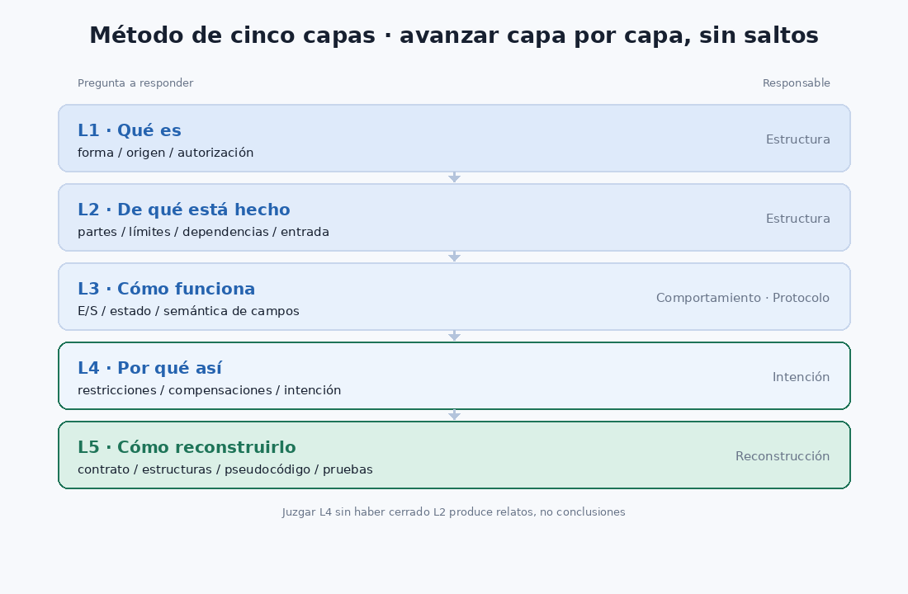

# Consejo de Expertos REA (Reverse Engineer Anything)

Convierte un **objetivo desconocido** en algo explicable y reproducible — un binario, una captura de paquetes, un repositorio, un archivo de datos, una interfaz de producto, o incluso un proceso de negocio.

Un **núcleo de decisión** coordina a **6 expertos de dominio** y dirige el **método de reconstrucción en cinco capas**, con un **mecanismo anti-alucinación** integrado (grado de evidencia E0–E3 + puerta de brecha de evidencia + puerta legal/seguridad).



- **Cero dependencias**: pura biblioteca estándar de Python — sin `pip install`, sin pesos descargados.
- **Cero red**: todo el juicio se ejecuta localmente.
- **Inspección de solo lectura**: `peek.py` nunca modifica ni ejecuta el objetivo.
- Los scripts restringen la salida, validan la confianza y registran los niveles de evidencia; el entorno que carga esta skill realiza el análisis real.

---

## Inicio rápido

```bash
# 1) Inspección — primero ver qué es
python3 scripts/peek.py <ruta>                # archivo: magia/entropía/cadenas/estructura
python3 scripts/peek.py <dir> --depth 3       # dir: distribución de tipos/entrada/alta entropía

# 2) Enrutado — qué expertos esta vez
python3 scripts/rea_engine.py route --state 'captura binaria de estructura desconocida con TLV'

# 3) Plantear + 4) Validar
python3 scripts/rea_engine.py prompt  --schema-file experts/protocol-decoder/schema.json --state '<desc>'
python3 scripts/rea_engine.py validate --schema-file experts/protocol-decoder/schema.json \
    --state '<desc>' --answer '{"format_class":{"value":"tlv","confidence":0.8,"evidence":"E2"}}'

# 5) Consenso y auditoría
python3 scripts/rea_engine.py consensus --results @results.json
python3 scripts/rea_engine.py audit

# autoprueba
python3 scripts/rea_engine.py selftest
```

---

## Método de reconstrucción en cinco capas

| Capa | Responde | Experto principal |
|---|---|---|
| L1 Qué es | forma, origen, estado de autorización | structure-anatomist |
| L2 De qué está hecho | partes, límites, dependencias, entrada | structure-anatomist |
| L3 Cómo funciona | entrada→salida, estado, semántica de campos | behavior-analyst / protocol-decoder |
| L4 Por qué así | restricciones, compromisos, intención de diseño | intent-reconstructor |
| L5 Cómo reconstruirlo | contrato, estructura, pseudocódigo, aceptación | rebuild-planner |

Avanza capa por capa — sin saltos. Hablar de L4 antes de tener clara L2 suele ser relato, no conclusión.



## El consejo de expertos

| Experto | Posee | Puerta clave |
|---|---|---|
| `structure-anatomist` | reconocimiento de forma, descomposición, límites y dependencias | `evidence_gap` |
| `behavior-analyst` | comportamiento en ejecución, máquina de estados, temporización, efectos | `needs_dynamic_probe` |
| `binary-reverser` | binario/bytecode, símbolos, ofuscación, flujo de control | `legal_or_safety_risk` (→ humano) |
| `protocol-decoder` | mensajes y formatos de datos, límites y semántica de campos | `speculation_risk` |
| `intent-reconstructor` | restricciones, compromisos, intención de diseño | `narrative_risk` |
| `rebuild-planner` | fijación de especificación, contrato, pseudocódigo, aceptación | `blocking_unknowns` |

## Grado de evidencia (núcleo anti-alucinación)

| Nivel | Significado | ¿En la conclusión? |
|---|---|---|
| E0 | Observación directa (bytes / línea fuente / salida) | ✅ |
| E1 | Inferencia fuerte (cadena completa, cada eslabón E0) | ✅ citar la cadena |
| E2 | Inferencia débil (patrón / experiencia, otras explicaciones posibles) | ⚠️ etiquetar "inferido" |
| E3 | Especulación (sin evidencia directa) | ❌ solo en "hipótesis a verificar" |

---

## Estructura de directorios

```
rea-expert-council/
├── SKILL.md                     # punto de entrada de la skill
├── skillhub.json                # metadatos de publicación SkillHub
├── icon.png                     # icono 512×512
├── scripts/
│   ├── rea_engine.py            # núcleo de decisión (route/prompt/validate/decide/consensus/audit)
│   ├── peek.py                  # inspección de objetivo sin dependencias
│   ├── install.py               # despliega sub-skills de expertos
│   └── publish.py               # genera paquete de subida SkillHub
├── experts/
│   ├── _registry.json           # registro de expertos (pesos + palabras disparadoras)
│   └── <domain>/{SKILL.md,schema.json}   # 6 expertos
├── assets/schemas/              # esquemas comunes (triaje / auditoría anti-alucinación)
├── references/                  # metodología: method / evidence / engine / expert-team
└── tests/run_tests.py           # pruebas de cadena completa
```

---

## Límites honestos

- La confianza es una **estimación autoinformada**, no una probabilidad calibrada; en trabajo de alto riesgo usa `min_confidence ≥ 0.7`.
- `peek.py` solo hace inspección de lectura — sin descifrado, sin desempaquetado, sin ejecución.
- El **baseline heurístico offline** integrado en el motor (magia/entropía/palabras clave) sirve de referencia objetiva.
- No provee ni realiza: eludir autorización, crackear licencias comerciales, o militarizar código malicioso.

## Instalación local

```bash
python3 scripts/install.py                 # nivel de usuario
python3 scripts/install.py --scope project # nivel de proyecto
python3 scripts/install.py --uninstall     # desinstalar
```

## Licencia

MIT — ver [LICENSE](LICENSE).
