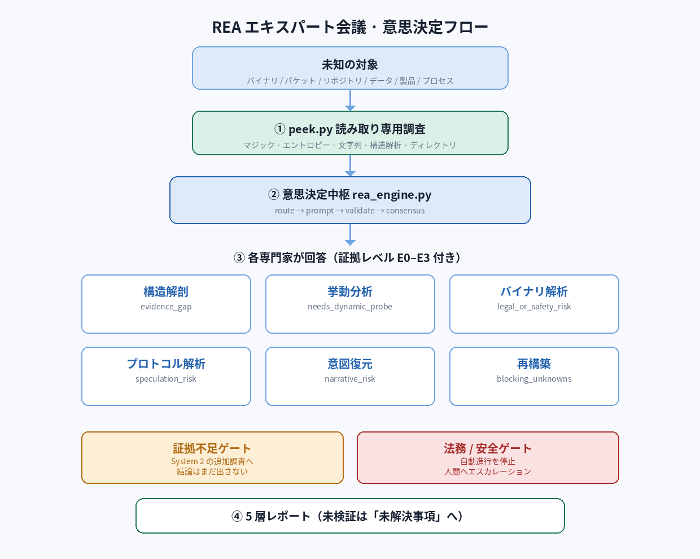
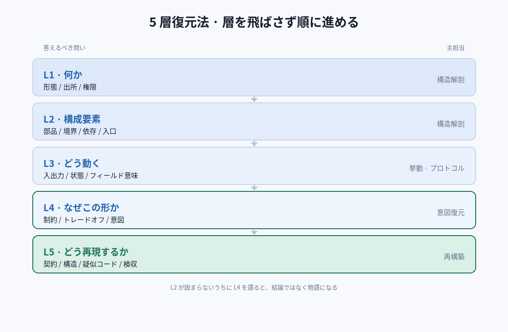

# REA 専門家評議会 (Reverse Engineer Anything)

未知の対象を、説明可能で再現可能な形へと還元する——バイナリ、パケットキャプチャ、リポジトリ、データファイル、製品の UI、あるいはビジネスプロセスさえも。

**意思決定コア**が **6 人のドメイン専門家**を調整し、**5 層再構築法**を推進。組み込みの**ハルシネーション防止機構**（E0–E3 証拠グレード + 証拠欠落ゲート + 法令/安全ゲート）を備える。



- **ゼロ依存**: 純粋な Python 標準ライブラリ——`pip install` 不要、重みのダウンロードもなし。
- **ゼロ通信**: すべての判断はローカルで実行。
- **読み取り専用の下見**: `peek.py` が対象を変更・実行することはない。
- スクリプトは出力を制約し、確信度を検証し、証拠レベルを記録する。本スキルを読み込んだ実行環境が実際の解析を行う。

---

## クイックスタート

```bash
# 1) 下見 — まずは「何か」を見る
python3 scripts/peek.py <パス>                # ファイル: マジック/エントロピー/文字列/構造
python3 scripts/peek.py <ディレクトリ> --depth 3       # ディレクトリ: 種別分布/エントリ/高エントロピー

# 2) ルーティング — 今回はどの専門家か
python3 scripts/rea_engine.py route --state 'TLV 構造を持つ未知のバイナリキャプチャ'

# 3) 出題 + 4) 検証
python3 scripts/rea_engine.py prompt  --schema-file experts/protocol-decoder/schema.json --state '<説明>'
python3 scripts/rea_engine.py validate --schema-file experts/protocol-decoder/schema.json \
    --state '<説明>' --answer '{"format_class":{"value":"tlv","confidence":0.8,"evidence":"E2"}}'

# 5) 合意と監査
python3 scripts/rea_engine.py consensus --results @results.json
python3 scripts/rea_engine.py audit

# 自己テスト
python3 scripts/rea_engine.py selftest
```

---

## 5 層再構築法

| 層 | 答える問い | 主担当 |
|---|---|---|
| L1 何か | 形態、出自、権限状態 | structure-anatomist |
| L2 何から成るか | 部品、境界、依存、エントリ | structure-anatomist |
| L3 どう動くか | 入力→出力、状態、フィールド意味 | behavior-analyst / protocol-decoder |
| L4 なぜこうか | 制約、トレードオフ、設計意図 | intent-reconstructor |
| L5 どう再構築するか | 契約、構造、擬似コード、検収 | rebuild-planner |

層を飛ばさずに進める。L2 が見える前に L4 を語るのは、たいてい「結論」ではなく「物語」になる。



## 専門家評議会

| 専門家 | 担う役割 | 主要ゲート |
|---|---|---|
| `structure-anatomist` | 形態認識、部品分解、境界と依存 | `evidence_gap` |
| `behavior-analyst` | 実行時挙動、状態機械、タイミング、副作用 | `needs_dynamic_probe` |
| `binary-reverser` | バイナリ/バイトコード、シンボル、難読化、制御流 | `legal_or_safety_risk`（→人間） |
| `protocol-decoder` | メッセージとデータ形式、フィールド境界と意味 | `speculation_risk` |
| `intent-reconstructor` | 制約、トレードオフ、設計意図 | `narrative_risk` |
| `rebuild-planner` | 仕様の固定、契約、擬似コード、検収 | `blocking_unknowns` |

## 証拠グレード（ハルシネーション防止の核心）

| レベル | 意味 | 結論に入るか |
|---|---|---|
| E0 | 直接観測（バイト / ソース行 / 実行出力） | ✅ |
| E1 | 強い推論（全リンク E0 の証拠連鎖） | ✅ 連鎖を明記 |
| E2 | 弱い推論（パターン / 経験、他解あり） | ⚠️ 「推論」と注記 |
| E3 | 憶測（直接証拠なし） | ❌ 「検証すべき仮説」のみ |

---

## ディレクトリ構造

```
rea-expert-council/
├── SKILL.md                     # スキル入り口
├── skillhub.json                # SkillHub 公開メタデータ
├── icon.png                     # 512×512 アイコン
├── scripts/
│   ├── rea_engine.py            # 意思決定コア (route/prompt/validate/decide/consensus/audit)
│   ├── peek.py                  # ゼロ依存の対象下見
│   ├── install.py               # 専門家サブスキルの展開
│   └── publish.py               # SkillHub アップロード包の生成
├── experts/
│   ├── _registry.json           # 専門家レジストリ（重み + トリガー語）
│   └── <domain>/{SKILL.md,schema.json}   # 6 専門家
├── assets/schemas/              # 共通スキーマ（トリアージ / ハルシネーション監査）
├── references/                  # メソドロジ: method / evidence / engine / expert-team
└── tests/run_tests.py           # 全チェーンテスト
```

---

## 率直な境界

- 確信度は**自己申告の推定値**であり、較正済み確率ではない。高リスクな場面では `min_confidence ≥ 0.7` を推奨。
- `peek.py` は読み取り専用の下見のみ——復号も、脱殻も、実行もしない。
- エンジン内蔵の**オフライン経験的ベースライン**（マジック/エントロピー/キーワード）は客観的参照として機能する。
- 権限の迂回、商用ライセンスの解除、悪性コードの武器化を提供・実行することはない。

## ローカルインストール

```bash
python3 scripts/install.py                 # ユーザー単位
python3 scripts/install.py --scope project # プロジェクト単位
python3 scripts/install.py --uninstall     # アンインストール
```

## ライセンス

MIT — [LICENSE](LICENSE) を参照。
