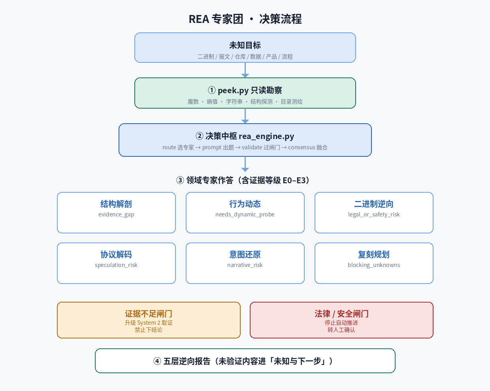
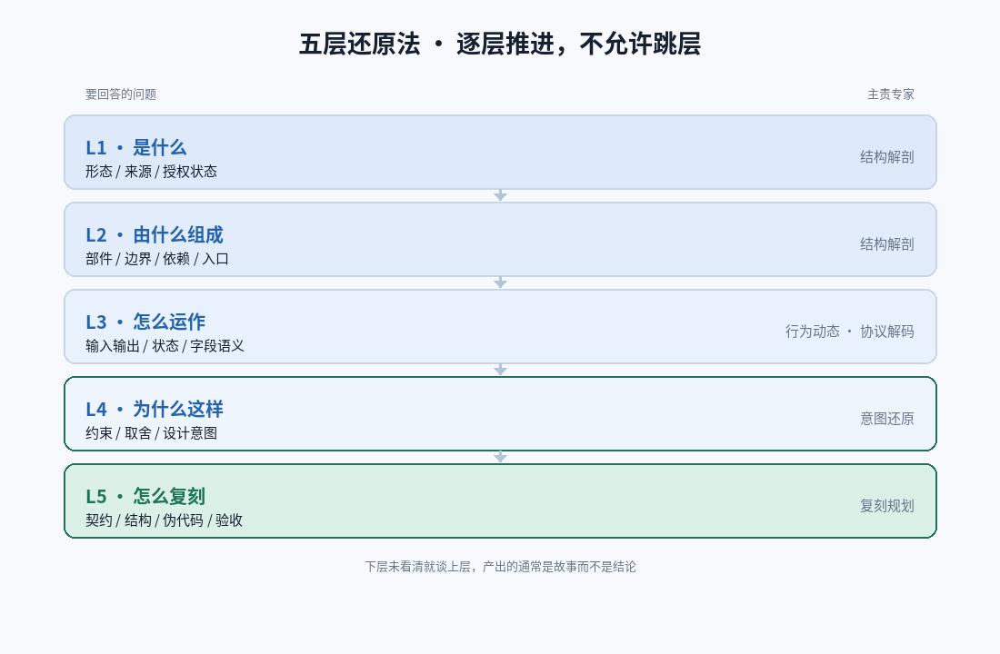

# REA 逆向工程专家团（Reverse Engineer Anything）

把一个**未知目标**还原到可解释、可复刻的程度 —— 一个二进制、一段报文、一个仓库、
一份数据文件、一个产品界面或一条业务流程。

一个**决策中枢**协调 **6 位领域专家**，按**五层还原法**推进，并内置
**反幻觉机制**（E0~E3 证据分级 + 证据不足闸门 + 法律/安全闸门）。

- **零依赖**：纯 Python 标准库，无需 pip install、不下载任何外部依赖
- **零联网**：所有判定在本地完成
- **只读勘察**：`peek.py` 绝不修改、绝不执行目标文件
- 脚本负责约束输出、校验置信度、记录证据等级；`rea_engine.py` 作为决策中枢按注册表调度各专家



---

## 快速开始

```bash
# ① 勘察：先看清它是什么
python3 scripts/peek.py <目标路径>              # 文件：魔数/熵值/字符串/结构探测
python3 scripts/peek.py <目录> --depth 3        # 目录：类型分布/入口点/高熵文件

# ② 路由：本次该上哪几位专家
python3 scripts/rea_engine.py route --state '未知格式的二进制抓包，含 TLV 结构'

# ③ 出题 + ④ 校验
python3 scripts/rea_engine.py prompt  --schema-file experts/protocol-decoder/schema.json --state '<描述>'
python3 scripts/rea_engine.py validate --schema-file experts/protocol-decoder/schema.json \
    --state '<描述>' --answer '{"format_class":{"value":"tlv","confidence":0.8,"evidence":"E2"}}'

# ⑤ 共识与审计
python3 scripts/rea_engine.py consensus --results @results.json
python3 scripts/rea_engine.py audit

# 自测
python3 scripts/rea_engine.py selftest
```

---

## 五层还原法

| 层 | 回答什么 | 主责专家 |
|---|---|---|
| L1 是什么 | 形态、来源、授权状态 | structure-anatomist |
| L2 由什么组成 | 部件、边界、依赖、入口 | structure-anatomist |
| L3 怎么运作 | 输入→输出、状态、字段语义 | behavior-analyst / protocol-decoder |
| L4 为什么这样 | 约束、取舍、设计意图 | intent-reconstructor |
| L5 怎么复刻 | 契约、结构、伪代码、验收 | rebuild-planner |

逐层推进，不允许跳层。L2 没看清就谈 L4，产出的通常是故事而不是结论。



## 专家团

| 专家 | 负责 | 关键闸门 |
|---|---|---|
| `structure-anatomist` | 形态识别、部件分解、边界与依赖 | `evidence_gap` |
| `behavior-analyst` | 运行行为、状态机、时序、副作用 | `needs_dynamic_probe` |
| `binary-reverser` | 二进制/字节码、符号、混淆、控制流 | `legal_or_safety_risk`（转人工） |
| `protocol-decoder` | 报文与数据格式、字段边界与语义 | `speculation_risk` |
| `intent-reconstructor` | 约束、取舍、设计意图 | `narrative_risk` |
| `rebuild-planner` | 规格固化、契约、伪代码、验收 | `blocking_unknowns` |

## 证据分级（反幻觉核心）

| 级别 | 含义 | 可否进结论 |
|---|---|---|
| E0 | 直接观测（字节/源码行/运行输出） | ✅ |
| E1 | 强推断（完整证据链，每环 E0） | ✅ 注明推断链 |
| E2 | 弱推断（模式/经验，可能有他解） | ⚠️ 需标注"推断" |
| E3 | 推测（无直接证据） | ❌ 只能进「待验证假设」 |

---

## 目录结构

```
rea-expert-council/
├── SKILL.md                     # 主技能入口
├── skillhub.json                # SkillHub 上架元信息
├── icon.png                     # 512×512 图标
├── scripts/
│   ├── rea_engine.py            # 决策中枢（route/prompt/validate/decide/consensus/audit）
│   ├── peek.py                  # 零依赖目标体检器
│   ├── install.py               # 部署专家子技能
│   └── publish.py               # 打包 SkillHub 上传包
├── experts/
│   ├── _registry.json           # 专家注册表（权重 + 触发词）
│   └── <domain>/{SKILL.md,schema.json}   # 6 位专家
├── assets/schemas/              # 通用题型（分诊 / 反幻觉审计）
├── references/                  # 方法论：method / evidence / engine / expert-team
└── tests/run_tests.py           # 全链路测试
```

---

## 诚实的边界

- 置信度是**自报估值**，非严格校准概率；高 stakes 场景建议 `min_confidence ≥ 0.7`。
- `peek.py` 只做只读勘察，不解密、不脱壳、不执行目标。
- 引擎内置的是**离线索赔 baseline**（魔数/熵值/关键词），用作客观校验参照。
- 不具备也不提供：绕过授权、破解商业许可、weaponize 恶意代码。

## SkillHub 上架

```bash
python3 scripts/publish.py --check   # 校验发布材料
python3 scripts/publish.py           # 生成 rea-expert-council-skillhub.zip
```

然后访问 https://skillhub.cn → 「发布团队 skill」→ 上传 zip → 提交审核。

## 本地安装

```bash
python3 scripts/install.py                 # 用户级
python3 scripts/install.py --scope project # 项目级
python3 scripts/install.py --uninstall     # 卸载
```

## 多语言文档

| 语言 | 文档 |
|---|---|
| 简体中文（本页） | [README.md](README.md) |
| English | [README.en.md](README.en.md) |
| العربية | [README.ar.md](README.ar.md) |
| 日本語 | [README.ja.md](README.ja.md) |
| Español | [README.es.md](README.es.md) |

## 许可证

MIT —— 见 [LICENSE](LICENSE)。

